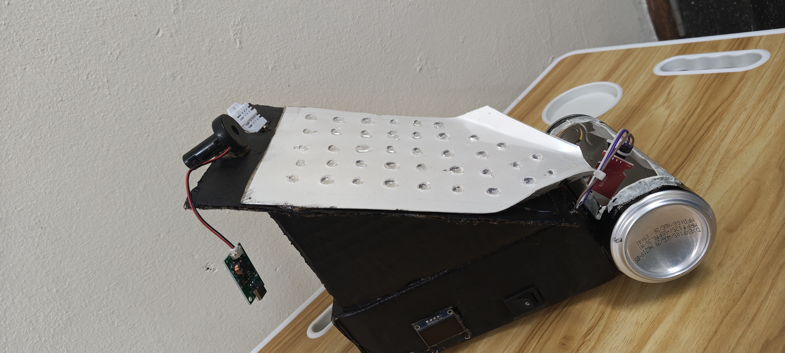

# Nature-Inspired Fog Harvesting Prototype using ESP32 🪲💧
A functional hardware prototype replicating the moisture-harvesting capabilities of the Namib Desert *Stenocara* beetle, built for my Semester 1 "Nature Inspired Engineering" course. 

**[Watch the working prototype and data logging video here](https://youtu.be/Q1aBB1ZBOv0)**

## Surface Coating Close-Up 

*Droplets nucleating on the hydrophilic PVA bumps and preparing to roll down the hydrophobic wax channels.*

## Tech Stack (ECE Integration)
*   **Microcontroller:** ESP32 (C++)
*   **Sensors:** DHT22 (Temperature/Humidity), Analog Water-Level Sensor
*   **Modules:** 0.96" I2C OLED Display, SPI MicroSD Card Module
*   **Core Concepts:** Biomimicry (Hydrophilic/Hydrophobic coatings), Analog-to-Digital Conversion (ADC), I2C & SPI Communication, Local Data Logging.

## Circuit Diagram

## How It Works
The acrylic panel is coated with a grid of hydrophilic bumps (PVA) and hydrophobic channels. Dense moisture nucleates on the bumps, grows, and rolls down the channels into a collection jar. The ESP32 processes the raw analog water-level data and ambient humidity, displays it live on the OLED screen.
